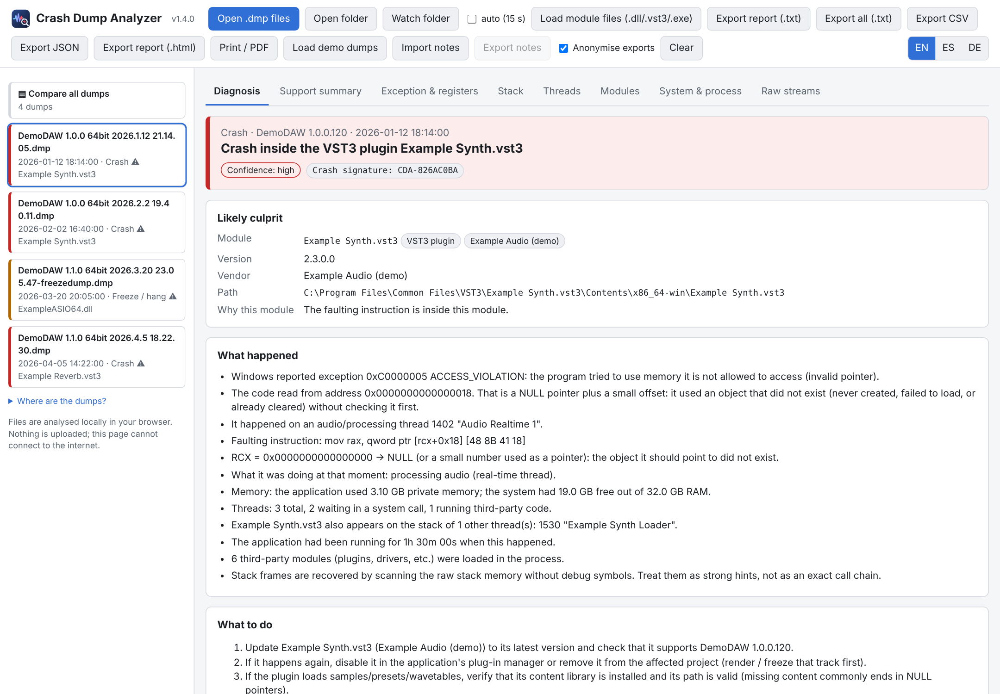
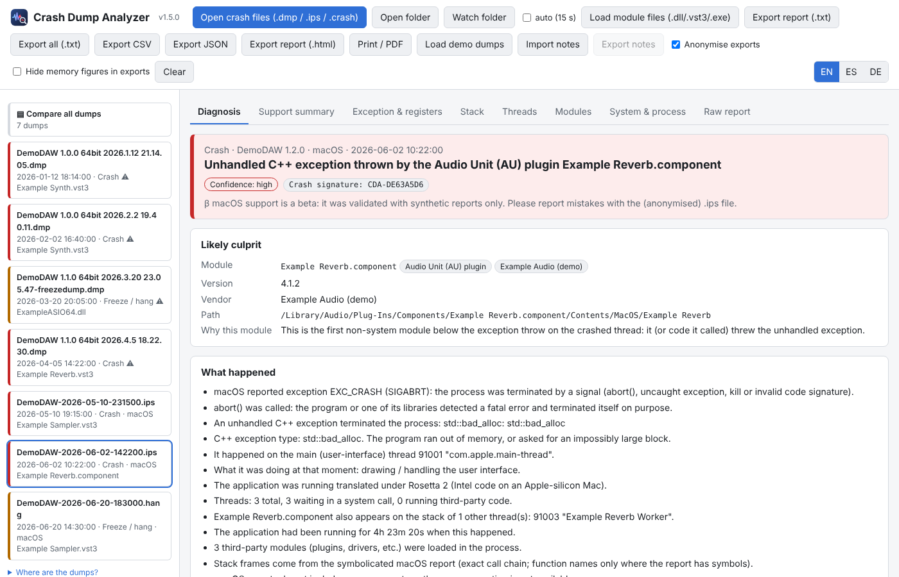
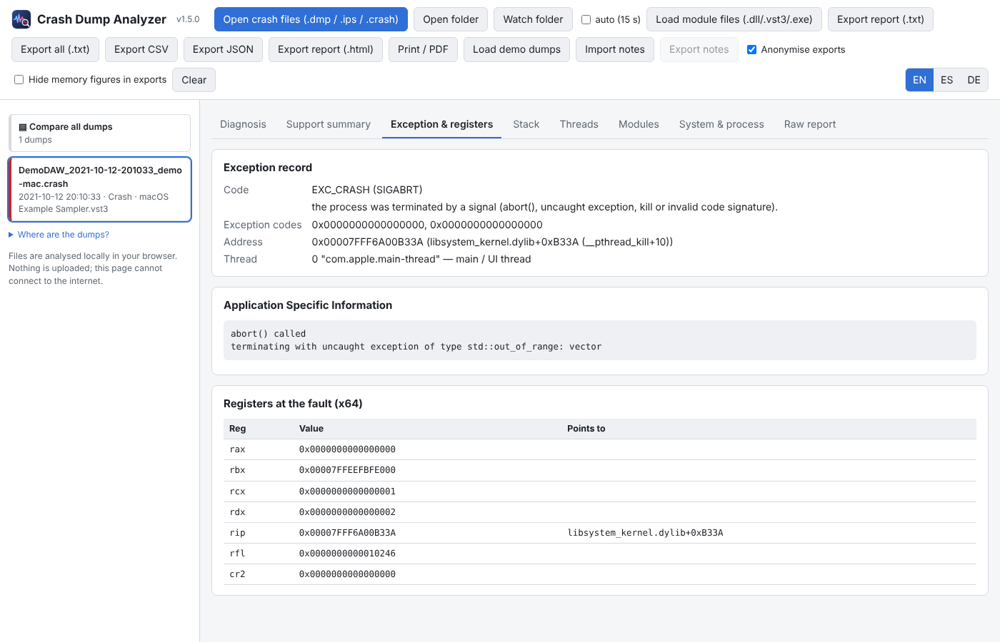
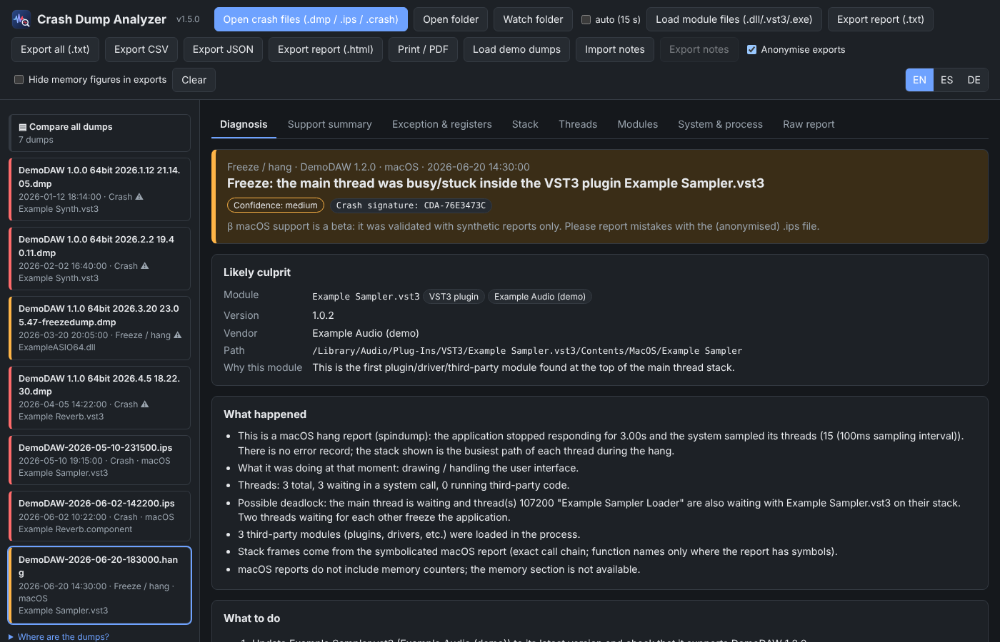
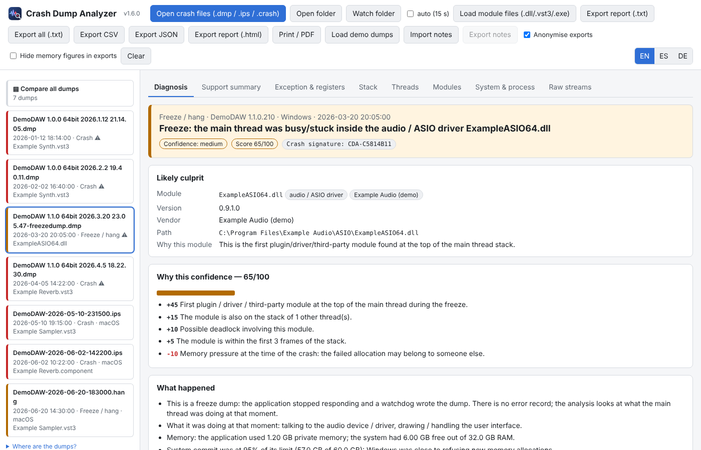
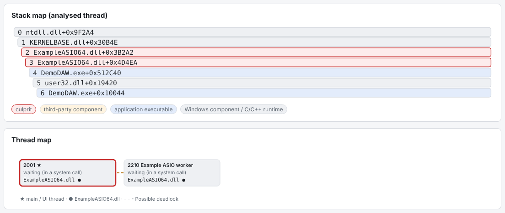
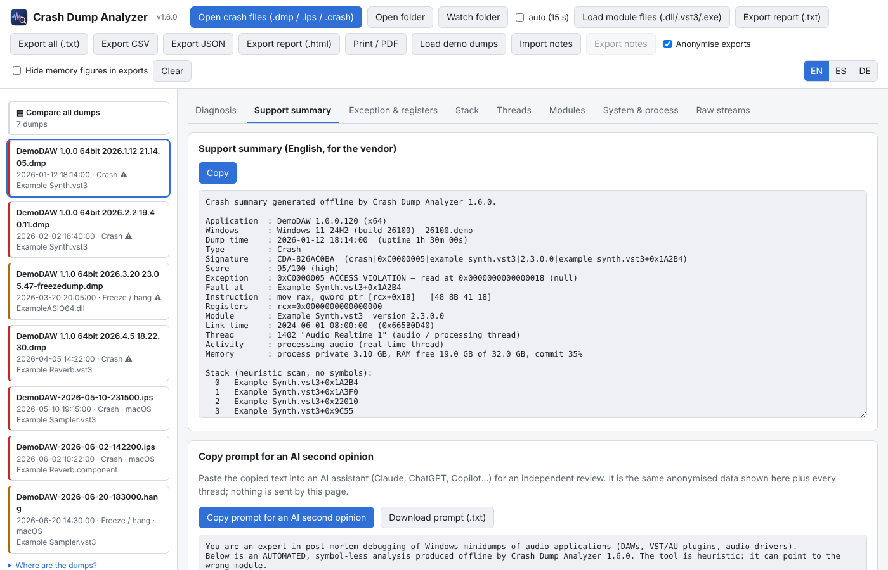
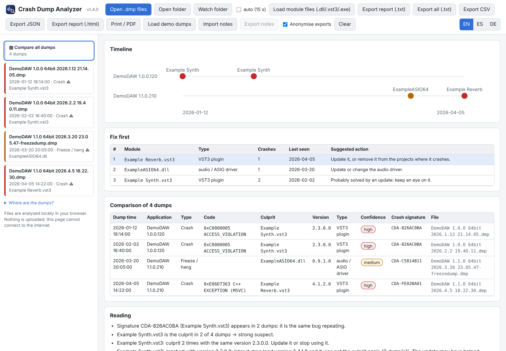

<p align="center"></p>

<h1 align="center">Crash Dump Analyzer</h1>

<p align="center"Offline crash-dump analyzer for Cubase and other DAWs: Windows .dmp and macOS .ips/.hang (beta). One HTML file, nothing uploaded.<br>
One HTML file · runs 100% offline in your browser · nothing is uploaded.</p>

<p align="center">
<a href="https://irregbex.github.io/crash-dump-analyzer/"><b>▶ Try it online</b></a> ·
<a href="../../releases/latest"><b>⬇ Download</b></a>
</p>



> The screenshots use the **built-in demo dumps**: fictional software ("DemoDAW", "Example Synth"), no real data.

## Why

When Cubase (or Nuendo, Dorico, or any Windows program) crashes, it writes a minidump
(`.dmp`) — for Steinberg apps in `%USERPROFILE%\Documents\Steinberg\CrashDumps`.
Those files are unreadable without a debugger such as WinDbg. Crash Dump Analyzer reads them and
explains, in plain language, what crashed and what to do about it.

On macOS the system writes a crash report instead (`~/Library/Logs/DiagnosticReports/*.ips`, or
`*.crash` on macOS 11 and older) and a `*.hang` spindump when an app stops responding. Since 1.5.0
the same page reads those too — **beta, untested on a real Mac**: the author has no Mac, so the
macOS reader was validated with synthetic reports only. If you have a `.ips` / `.hang` from a Cubase
crash, please try it and report what you get (anonymised export) in the issues — testers wanted.



<details><summary>More screenshots: legacy <code>.crash</code> report · dark theme with a <code>.hang</code> report</summary>





</details>

## What it shows

- **The culprit**: the plugin (VST3/VST2/CLAP/AAX, and Audio Units on macOS), audio/ASIO driver,
  graphics driver, application component or OS module, with a confidence level and the reason.
- **What happened**: exception type, the exact faulting x64 instruction and which register held
  the bad pointer (e.g. `mov rax,[rcx+0x18]` with `RCX = 0` → NULL pointer), the C++ exception
  type (`std::bad_alloc`…), the thread (UI, audio, worker) and what it was doing.
- **Freezes**: what the main thread was stuck in, an overview of all threads and hints of a
  possible deadlock.
- **Memory** at the moment of the crash: process memory, free RAM, Windows commit vs. limit
  (Windows dumps only; can be left out of exports with *Hide memory figures in exports*).
- **Warnings**: the same plugin loaded as VST2 and VST3, very old plugin binaries, plugins the
  vendor lists as legacy.
- **Crash signature** (`CDA-XXXXXXXX`): the same signature means the same bug in the same build.
- **Confidence you can audit** (1.6.0): a 0–100 score with every piece of evidence listed
  (*"+15 the module is also on the stack of 2 other threads"*, *"−15 heap corruption: the module
  that noticed it is not necessarily the one that caused it"*), and an explicit *"lead, not a
  verdict"* warning when the evidence is thin. A plugin active on several threads can overrule the
  "nearest module" guess when the fault itself is in Windows code.
- **MIDI, heap corruption and known patterns** (1.6.0): Windows MIDI Services / CoreMIDI / vendor
  MIDI drivers get their own module kind, activity and advice (incl. where to report); heap
  corruption and `/GS` fast-fails are explained (who noticed vs. who corrupted, page-heap recipe);
  PACE/iLok, WebView2, Thesycon, ASIO4ALL, old C runtimes, GDI and the D3D shader compiler are
  recognised with their usual cause.
- **AI second opinion** (1.6.0): one button copies an anonymised, self-contained prompt (summary,
  score, all threads, modules) to paste into Claude, ChatGPT or Copilot for an independent review.
  The page itself still never connects to anything.
- **Diagrams** (1.6.0): a stack map (who owns each frame) and a thread map with deadlock links.
- **Many dumps at once**: timeline, *fix first* ranking, repeat offenders, plugin versions that
  changed between crashes.
- **For support tickets**: an English summary ready to paste, a printable report / PDF, and
  TXT, CSV, JSON and self-contained HTML exports — anonymised by default (user name and personal
  folders removed).
- **Personal notes** per plugin (saved to / loaded from a `.json` file).
- Optional **exact x64 stack unwinding** if you also load the `.dll` / `.vst3` / `.exe` files
  involved (only exact build matches are used).
- **macOS (beta)**: `EXC_BAD_ACCESS` / `EXC_CRASH` (abort, uncaught C++ and Objective-C
  exceptions, invalid code signature) / `EXC_BREAKPOINT` and friends explained, Rosetta 2 detection,
  symbolicated frames as the system wrote them, hang reports (`.hang` / `.spin` spindumps) with
  duration, samples per thread and deadlock hints, and the same signature / comparison / exports.
- Interface in **English, Spanish and German**.



<details><summary>More: stack / thread diagrams · AI second-opinion prompt · comparison of several dumps</summary>







</details>

## How to use

1. Open `CrashDumpAnalyzer.html` (online link above, or download it and double-click).
   Chrome, Edge or Firefox (tested in all three); "Watch folder" needs Chrome or Edge.
2. Drag your `.dmp` (Windows) or `.ips` / `.crash` / `.hang` (macOS) files or a whole folder onto
   the page — or press **Load demo dumps** to try it (4 Windows dumps + 3 macOS reports, all
   fictional).
3. Read the **Diagnosis** tab; with two or more dumps use **Compare all dumps**.
4. Use **Support summary**, **Print / PDF** or **Export report (.html)** to send the details to
   the plugin developer — or **Copy prompt for an AI second opinion** when the confidence score is
   low and you want an independent read.

## Privacy

- The page sets a Content-Security-Policy with `connect-src 'none'`: it **cannot** open network
  connections, even when opened from GitHub Pages. Files are read locally with the File API.
- No cookies, no localStorage, no analytics. Notes and the watched-folder permission live only
  in the open tab.
- Exports are anonymised by default. A `.dmp` file itself contains process memory: be careful
  when sharing the dump, not the report.

## Limitations

- Windows minidumps: x64 fully; x86 and ARM64 basic. No debug symbols: code locations are
  *module + offset*, not function names; stack frames come from a heuristic scan unless module
  files are loaded.
- macOS: **beta**. Crash reports (`bug_type` 309, `.crash`) and hang reports (`bug_type` 288,
  `.hang` / `.spin`: target process and the busiest branch of every thread only). No memory
  counters and no faulting-instruction analysis (the reports do not contain them). Not yet tested
  with real Cubase reports.
- Dropping a *folder* onto the page can fail in Chrome/Edge/Brave depending on the path (the
  browser's own `EncodingError`); the page then says so — use **Open folder** instead. Single
  files always work.
- A diagnostic aid, not a fix: the culprit is a *lead* whose strength is shown as a score with its
  evidence. Not affiliated with Steinberg, Microsoft or any plugin vendor.

## For developers

Everything is in `CrashDumpAnalyzer.html`: a DOM-free **CORE** block (minidump parser, macOS
`.ips` / `.crash` parsers, analyzers, x64 decoder and unwinder, report builders, demo generators)
between `/*CORE-BEGIN*/` and `/*CORE-END*/`, and a **UI** block. No build step, no dependencies.

```
node tests/core_test.js CrashDumpAnalyzer.html            # demo dumps only
node tests/core_test.js CrashDumpAnalyzer.html <folder>    # plus your own .dmp files
```

Full user guide in [English](docs/README-en.txt), [Spanish](docs/README-es.txt) and
[German](docs/README-de.txt). Technical documentation (Spanish): [`docs/`](docs/) — structure
offsets, algorithms and rules.

## License

[MIT](LICENSE)
